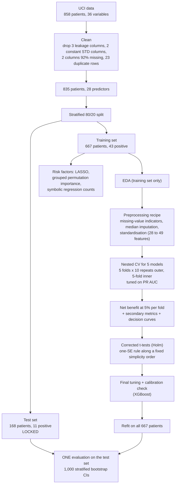
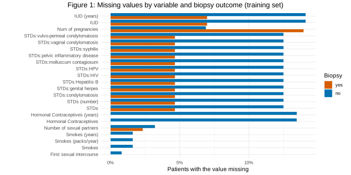
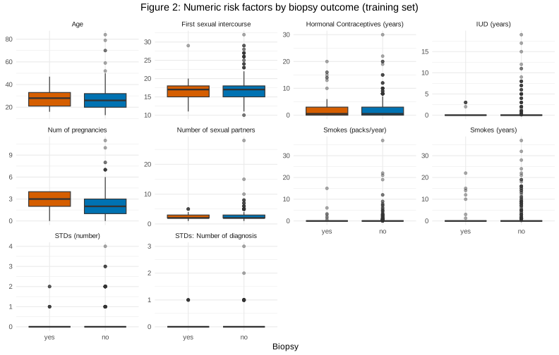
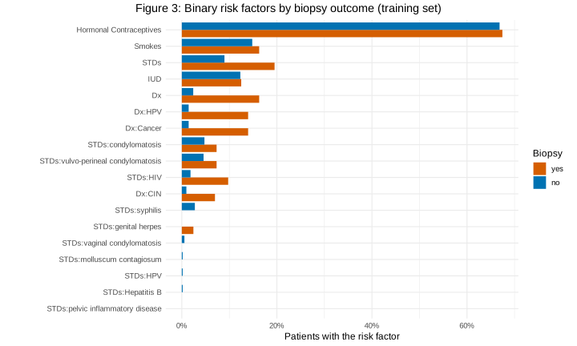
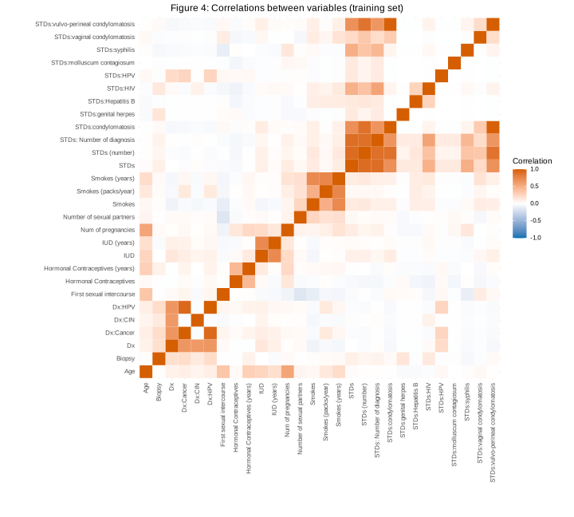
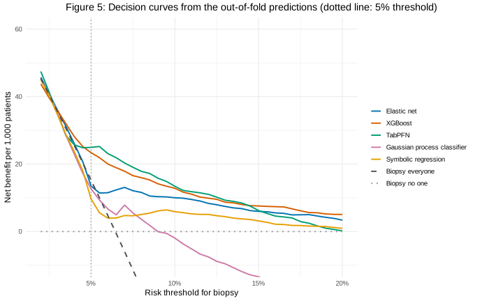
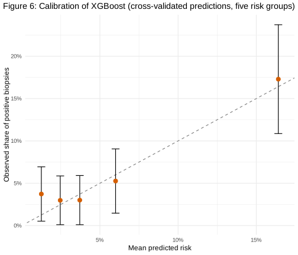
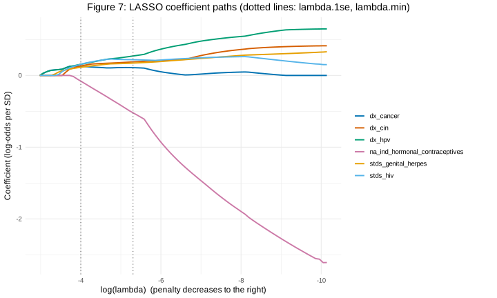
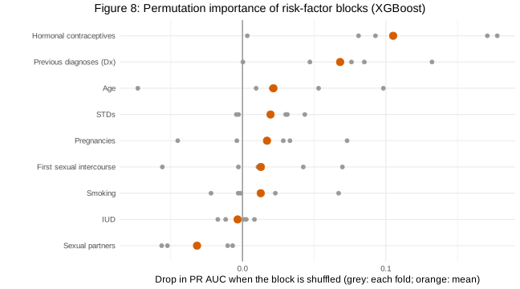

# Predicting Cervical Biopsy Outcomes from Health and Lifestyle Variables

[](https://colab.research.google.com/github/JIALE491/cervical-biopsy-risk-prediction/blob/main/cervical_biopsy_risk_prediction.ipynb)


An end-to-end clinical machine learning study in R. It asks whether a patient's demographic, behavioural and medical
risk factors can decide **who should receive a cervical biopsy** better than the two default strategies, biopsying every
patient or biopsying no one.

Five models from five different families are compared under **nested cross-validation**. They are judged by
**net benefit**, a decision-analytic metric that prices every unnecessary biopsy against every positive biopsy found.
The selected model is then evaluated **once** on a locked test set. The study also asks which risk factors are
consistently linked to a positive biopsy, using three importance methods with different assumptions.

> **Headline.** In cross-validation, TabPFN (24.9 per 1,000 patients) and XGBoost (23.4) beat biopsying everyone
> (15.2), but no difference was statistically significant after Holm adjustment. On the locked test set, the selected
> XGBoost model reached a net benefit of 6.0 per 1,000 against 16.3 for biopsying everyone, with an ROC AUC of 0.45.
> The pipeline was audited, and the gap is traced to the test set's 11 positives, none of whom had the model's
> second most important risk factor. This is an honest negative result: on 835 patients with 54 positives, these risk
> factors are not yet a reliable basis for biopsy decisions.

📄 **Full report (15-page PDF):** [`report/cervical_biopsy_risk_report.pdf`](report/cervical_biopsy_risk_report.pdf)
&nbsp;·&nbsp; 📓 **Notebook:** [`cervical_biopsy_risk_prediction.ipynb`](cervical_biopsy_risk_prediction.ipynb)

---

## Contents

1. [Why this project is interesting](#1-why-this-project-is-interesting)
2. [The problem](#2-the-problem)
3. [Data](#3-data)
4. [Pipeline at a glance](#4-pipeline-at-a-glance)
5. [Exploratory data analysis](#5-exploratory-data-analysis)
6. [Preprocessing and leakage control](#6-preprocessing-and-leakage-control)
7. [Evaluation design: net benefit](#7-evaluation-design-net-benefit)
8. [The five models](#8-the-five-models)
9. [Cross-validation results and model selection](#9-cross-validation-results-and-model-selection)
10. [Final model on the locked test set](#10-final-model-on-the-locked-test-set)
11. [Which risk factors matter?](#11-which-risk-factors-matter)
12. [Limitations](#12-limitations)
13. [Reproducing the results](#13-reproducing-the-results)
14. [Repository structure](#14-repository-structure)
15. [Tech stack](#15-tech-stack)
16. [References](#16-references)

---

## 1. Why this project is interesting

Most projects on this data set report accuracy or ROC AUC and stop there. This project treats the model as a
**decision tool** and evaluates it the way a clinic would use it:

| Design choice | Why it matters |
| :--- | :--- |
| **Leakage removed before modelling** | Three columns (Hinselmann, Schiller, Cytology) are tests done *alongside* the biopsy. Keeping them inflates every metric and gives a model that cannot be used at the moment of decision. |
| **Nested cross-validation (5 × 10 outer, 5 inner)** | Hyperparameters are tuned only inside each outer fold, so the 50 outer-fold scores are unbiased estimates of out-of-sample performance. |
| **One recipe, re-fitted in every split** | Imputation medians, missing-value indicators and scaling are learned from the training part of each split only. No validation or test information reaches the models. |
| **Net benefit as the single primary criterion** | Accuracy is 93.6% for a model that says "negative" to everyone. Net benefit asks the clinical question directly: does the model beat biopsying everyone? |
| **Threshold fixed on clinical grounds, before testing** | The 5% risk threshold is anchored to the 2019 ASCCP guideline (colposcopy at ≥ 4% immediate CIN 3+ risk), not tuned on the data. |
| **Pre-registered model selection** | The one-standard-error rule along a simplicity order fixed in advance picks the final model, so the choice cannot be steered by the results. |
| **Honest statistics** | Corrected resampled t-tests (Nadeau & Bengio) account for overlapping training sets across folds, with Holm adjustment for multiple comparisons. |
| **A single, locked test evaluation** | The test set was opened once, with 1,000 stratified bootstrap 95% CIs. When the result disappointed, the pipeline was audited, and the model was **not** changed afterwards. |
| **Models from five different families** | A penalised linear model, gradient-boosted trees, a pretrained transformer (TabPFN), a Bayesian kernel method and evolutionary symbolic regression, each answering a different question. |
| **Triangulated explanations** | Risk factors are ranked by LASSO, grouped permutation importance and symbolic-regression formula counts. A factor all three agree on is more likely to be real. |

---

## 2. The problem

Cervical cancer is the fifth most commonly diagnosed cancer in women: about 604,000 new cases and 280,000 deaths
worldwide in 2024, with the highest burden in low- and middle-income countries (WHO, 2026). Almost all cases are caused
by persistent high-risk HPV infection. Co-factors such as HIV, other sexually transmitted infections, parity,
hormonal contraceptive use and smoking raise the risk of progression.

A histological biopsy is the diagnostic gold standard, but where resources are limited, clinics must decide **whom to
biopsy**. A questionnaire-based risk model would be a cheap, non-invasive triage tool.

**Objectives**

1. **Prediction:** can machine learning on demographic, behavioural and medical risk factors decide who needs a biopsy
   better than biopsying everyone or biopsying no one?
2. **Explanation:** which risk factors are consistently linked to a positive biopsy?

---

## 3. Data

**UCI Cervical Cancer (Risk Factors)**, collected at Hospital Universitario de Caracas, Venezuela
(Fernandes et al., 2017). 858 patients, 36 variables. The notebook downloads it directly from the UCI repository, so
no data file is stored here.

| Variable group | Examples |
| :--- | :--- |
| Demographics | Age |
| Sexual and reproductive history | Number of sexual partners, first sexual intercourse, number of pregnancies |
| Smoking | Smokes, years, packs/year |
| Contraception | Hormonal contraceptives (and years), IUD (and years) |
| Sexually transmitted diseases | 12 STD indicators, number of STDs, number of diagnoses |
| Previous diagnoses | Dx, Dx:HPV, Dx:CIN, Dx:Cancer |
| Outcomes | Hinselmann, Schiller, Citology, **Biopsy** (target) |

**Target:** `Biopsy` (1 = positive), because histology is the definitive diagnostic endpoint.

**Three challenges shape the whole design:**

- **Severe class imbalance:** 6.5% positive.
- **Block missingness:** whole questionnaire sections were skipped, and skipping carries outcome signal.
- **Block multicollinearity:** related exposures are strongly correlated (STD variables up to r = 0.98).

---

## 4. Pipeline at a glance



The notebook follows these steps in order, and every code cell is labelled with its step number (Steps 1–25).

---

## 5. Exploratory data analysis

All EDA uses the **training set only**. Each table and figure motivates a later modelling choice.

**Class balance.** Only 43 of 667 training patients (6.4%) had a positive biopsy, so a model that predicts "negative"
for everyone is 93.6% accurate. Accuracy is useless here, which motivates stratified splits and a decision-based metric.

**Missingness is informative (Figure 1).** Values are missing in whole questionnaire blocks, not at random. None of
the 74 patients who skipped the STD, contraceptive and IUD sections together had a positive biopsy (0.0% vs 6.8% among
complete responders). So each variable gets a **missing-value indicator** alongside **median imputation**.

<p align="center"></p>

**Skewed numeric variables (Figure 2).** Duration and count variables are zero-inflated with extreme outliers
(up to 30 contraceptive years and 37 smoking years). This justifies **median** rather than mean imputation. Scales
differ widely (Age 13–84 vs number of STD diagnoses 0–3), so all predictors are **standardised** for the distance-based
kernel (GPC) and the shrinkage penalties (elastic net).

<p align="center"></p>

**Rare, high-signal binary flags (Figure 3).** Biopsy-positive patients have far higher rates of previous diagnoses:
Dx 16% vs 2%, Dx:HPV and Dx:Cancer 14% vs 1.5%, Dx:CIN 7% vs 1%. STD history is also higher (20% vs 9%), and HIV
10% vs 2%. Seven STD subtypes each appear in at most 3% of patients, which motivates regularised models that resist
overfitting rare flags.

<p align="center"></p>

**Weak marginal signal, strong blocks (Figure 4).** Every single predictor correlates weakly with Biopsy (all
r ≤ 0.207, led by Dx:Cancer and Dx:HPV). This motivates multivariable and non-linear models that combine weak
signals. Four tightly correlated blocks appear (STDs, smoking, contraception, previous diagnoses). They motivate
elastic net and *grouped* permutation importance.

<p align="center"></p>

---

## 6. Preprocessing and leakage control

**Removed before the split (7 columns, 23 rows):**

| Removed | Reason |
| :--- | :--- |
| Hinselmann, Schiller, Citology | Diagnostic tests done alongside the biopsy: not available at decision time, and they leak the outcome. |
| STDs:cervical condylomatosis, STDs:AIDS | Zero for every patient. |
| STDs: Time since first / last diagnosis | 92% missing. |
| 23 exact duplicate rows | Would sit on both sides of a split and inflate scores. |

**The split.** 835 patients, stratified 80/20 by outcome: 667 for training (43 positive) and 168 for testing
(11 positive). With only 6.4% positives, rsample's default `pool = 0.1` would merge the minority class into one
stratum and give an **unstratified** split, so `pool = 0` is used to force true stratification.

**One recipe (tidymodels `recipes`), re-fitted inside every split:**

1. A missing-value indicator for each variable (not for symbolic regression, so its formulas use clinical
   factors only).
2. Median imputation (robust to the skew in Figure 2).
3. Removal of constant columns.
4. Standardisation.

This turns 28 predictors into 49 and fills all 1,415 missing values.

**Tried and rejected: SMOTE-NC.** Synthetic oversampling destroyed the rare risk factors: Dx:HPV fell from 14% of
positive patients to 0%, and every model performed worse than chance. Class imbalance is handled instead by stratified
folds, PR AUC for tuning, and net benefit for evaluation.

---

## 7. Evaluation design: net benefit

The primary criterion is **net benefit at a 5% risk threshold** (decision curve analysis; Vickers & Elkin, 2006):

$$NB = \frac{TP}{n} - \frac{FP}{n} \times \frac{p_t}{1 - p_t}$$

Every patient whose predicted risk is at least $p_t$ is biopsied. At $p_t = 5\%$, each unnecessary biopsy costs
$5/95 = 1/19$ of a positive biopsy found, so finding one positive biopsy is worth up to 19 unnecessary ones.

**Why 5%?** Choosing $p_t$ means a patient with risk exactly $p_t$ is equally well off with or without a biopsy, so
the weight $p_t/(1-p_t)$ follows from decision theory. A biopsy is a minor procedure and a missed precancer is costly,
so the threshold should be low. The 2019 ASCCP guidelines recommend colposcopy (where biopsies are taken) at an
immediate CIN 3+ risk of 4% or more (Perkins et al., 2020). A positive biopsy is a broader outcome than CIN 3+, so a
slightly higher 5% was used. It was **fixed before the test set was opened**.

**The bar a model must clear.** A useful model must beat both default strategies:

- **Biopsy no one:** NB = 0.
- **Biopsy everyone:** NB = 43/667 − (624/667) × (1/19) ≈ **15.2 per 1,000** patients.

The maximum possible value is the prevalence, 64 per 1,000.

**Secondary metrics.**

- **PR AUC (average precision):** used for tuning hyperparameters, because it scores the whole ranking rather than one
  noisy cut-off. A random ranking scores 0.064.
- **Also reported:** ROC AUC, and sensitivity and specificity at 5%.
- **Decision curves from 2% to 20%:** show whether conclusions depend on the exact threshold.

**Comparison and selection.**

- **Corrected resampled t-tests** (Nadeau & Bengio, 2003) with Holm adjustment. The correction accounts for the
  overlap between training sets across folds, which makes naive t-tests far too optimistic.
- The final model is chosen by the **one-SE rule** along a simplicity order fixed in advance: elastic net → symbolic
  regression → GPC → XGBoost → TabPFN. The corrected SE is SD × √(1/50 + 1/4).

---

## 8. The five models

All five share **identical nested cross-validation splits**: 5 stratified outer folds × 10 repeats = 50 outer folds,
each tuned by 5-fold inner CV on PR AUC, with the recipe re-fitted inside every split.

| Model | Family | Question it answers | Tuned | Package |
| :--- | :--- | :--- | :--- | :--- |
| **Elastic net** | Penalised linear model | Which risk factors matter in a linear baseline? | λ (10 values in 10⁻⁴–1), α ∈ {0.2, 0.4, 0.6, 0.8} | `glmnet` |
| **XGBoost** | Gradient-boosted trees | How much signal lies in non-linear interactions? | depth ∈ {2, 4}, η ∈ {0.03, 0.1} | `xgboost` |
| **TabPFN v2** | Pretrained transformer | Can pretraining on synthetic data beat small-sample fits? | none | `tabpfn` 9.2.0 via `reticulate` |
| **Gaussian process classifier** | Bayesian kernel method | Is risk driven by smooth similarity to known positives? | σ ∈ {0.0005, 0.002, 0.01, 0.05, 0.2} | `kernlab` |
| **Symbolic regression** | Evolutionary search | Can biopsy risk be written as a short, readable equation? | length penalty λ ∈ {0.002, 0.01}, max depth ∈ {3, 5} | `gramEvol` |

<details>
<summary><b>Elastic net: how it trains and predicts</b></summary>

Logistic regression with a mixed $L_1$/$L_2$ penalty (Zou & Hastie, 2005):

$$\min_{\beta_0, \beta} \left[ -\frac{1}{N} \sum_{i=1}^N \Big( y_i \log p(X_i) + (1 - y_i) \log(1 - p(X_i)) \Big) + \lambda \left( \frac{1 - \alpha}{2} \lVert\beta\rVert_2^2 + \alpha \lVert\beta\rVert_1 \right) \right]$$

with $p(X) = 1/(1 + e^{-(\beta_0 + \beta^\top X)})$. The $L_1$ part sets weak coefficients to zero. The $L_2$ part
shares weight across correlated blocks instead of dropping a whole cluster at random. Prediction is the logistic
function of the linear score.

</details>

<details>
<summary><b>XGBoost: how it trains and predicts</b></summary>

300 boosting rounds with 80% row subsampling (Chen & Guestrin, 2016). In each round, every patient gets the gradient
$g_i = \hat p_i - y_i$ and curvature $h_i = \hat p_i (1 - \hat p_i)$ of the logistic loss. A new tree is grown greedily
up to the tuned depth, and each split maximises

$$\text{Gain} = \tfrac{1}{2}\left[\frac{G_L^2}{H_L + \lambda} + \frac{G_R^2}{H_R + \lambda} - \frac{(G_L + G_R)^2}{H_L + H_R + \lambda}\right] - \gamma .$$

Each leaf gets the weight $w = -G/(H + \lambda)$, shrunk by the learning rate $\eta$. A prediction is the sum of the
patient's leaf weights over all 300 trees, passed through the logistic function.

</details>

<details>
<summary><b>TabPFN v2: how it "trains" and predicts</b></summary>

A transformer pretrained on about 130 million synthetic tabular data sets drawn from random structural causal models
(Hollmann et al., 2025). It approximates the Bayesian posterior predictive distribution
$p(y \mid x, D) = \int p(y \mid x, \phi)\, p(\phi \mid D)\, d\phi$ (Müller et al., 2022).

All learning happened in pretraining. On our data, `fit()` changes no weights: it stores the training patients. At
prediction time, the training patients (with labels) and the new patients pass through the network together. Attention
runs across features within each patient and across patients within each feature, so the network infers the
feature–outcome relationship from the training rows in context. The default classifier averages 8 passes with shuffled
feature orders.

It is called from R through `reticulate`, using the publicly available v2 weights on CPU.

</details>

<details>
<summary><b>Gaussian process classifier: how it trains and predicts</b></summary>

A zero-mean GP prior over a latent function with an RBF kernel $k(X, X') = \exp(-\sigma \lVert X - X' \rVert^2)$ and a
logistic link (Rasmussen & Williams, 2006). `kernlab::gausspr` writes the latent function as
$f(X) = \sum_i \alpha_i k(X, X_i)$ and finds the posterior mode by Newton iterations. A new patient's risk is
$1/(1 + e^{-f(X_*)})$, using the same weighted sum of similarities to the training patients. Small σ gives a smooth
risk surface shaped by many patients, and large σ makes it local.

</details>

<details>
<summary><b>Symbolic regression: how it searches</b></summary>

Grammatical evolution (`gramEvol`; O'Neill & Ryan, 2001; Noorian et al., 2016) searches for the *form* of an
equation built from the standardised risk factors, the constants {0.5, 1, 2} and the operators {+, −, ×}. Each
formula is turned into a risk by logistic regression, $\text{logit}\, p = a + b f(X)$.

A candidate is an integer genome that the grammar decodes, left to right, into a formula, so every genome gives a
valid formula. The fitness to maximise is training average precision minus a length penalty, $AP(f) - \lambda |f|$.
For a single formula with a recursive grammar, `gramEvol`'s evolution strategy makes each generation 60 new random
formulas plus the best so far. So the search compared 3,600 formulas (60 × 60 generations) and kept the best.

Missing-value indicators are excluded, so the formulas contain clinical factors only.

</details>

---

## 9. Cross-validation results and model selection

All results come from the saved out-of-fold predictions of the 50 outer folds.

**Table 5. Net benefit at the 5% risk threshold and secondary metrics (50 outer folds)**

| Strategy | Net benefit per 1,000 (mean ± SD) | Folds beating biopsy everyone (of 50) | PR AUC (mean ± SD) | ROC AUC (mean ± SD) | Sensitivity at 5% | Specificity at 5% |
| :--- | :--- | :---: | :--- | :--- | :---: | :---: |
| **TabPFN** | **24.9 ± 11.1** | 42 | 0.258 ± 0.127 | 0.708 ± 0.103 | 0.560 | 0.773 |
| **XGBoost** | **23.4 ± 11.9** | 42 | **0.279 ± 0.119** | **0.719 ± 0.090** | 0.600 | 0.689 |
| Elastic net | 13.5 ± 10.4 | 23 | 0.205 ± 0.115 | 0.623 ± 0.092 | 0.637 | 0.440 |
| Gaussian process classifier | 12.7 ± 7.6 | 27 | 0.180 ± 0.084 | 0.623 ± 0.106 | 0.849 | 0.146 |
| Symbolic regression | 9.7 ± 10.5 | 18 | 0.150 ± 0.094 | 0.521 ± 0.106 | 0.660 | 0.332 |
| *Biopsy everyone* | *15.2 ± 3.5* | – | – | – | 1.000 | 0.000 |
| *Biopsy no one* | *0.0 ± 0.0* | – | – | – | 0.000 | 1.000 |

*No-skill PR AUC = 0.064. Sensitivity and specificity are the mean of the 10 repeats, with predictions pooled within
each repeat. ROC AUC is added here from the notebook's model sections.*

**How to read it.** Net benefit counts the positive biopsies found per 1,000 patients, minus 1/19 for each unnecessary
biopsy. A model beats biopsying everyone only if the unnecessary biopsies it avoids, divided by 19, outnumber the
positives it misses.

- **TabPFN and XGBoost** beat biopsying everyone on average, and in 42 of 50 folds each.
- **Elastic net, GPC and symbolic regression** fell *below* biopsying everyone. At this threshold they would do more
  harm than simply biopsying every patient. They flag most patients as high risk (specificity ≤ 0.44).

**Decision curves (Figure 5).** TabPFN and XGBoost have the highest net benefit at every threshold from 5% to 15%.
Below about 4%, every model is within about 2 per 1,000 of biopsying everyone.

<p align="center"></p>

**Statistics.** No pairwise difference in net benefit was significant after the corrected t-test and Holm adjustment
(smallest adjusted p = 0.263). The advantage of TabPFN and XGBoost over biopsying everyone (+9.7 and +8.2 per 1,000)
was not significant either (adjusted p = 0.849 and 1.000). With 43 training positives, these differences cannot be
confirmed.

**Selection.** TabPFN had the highest mean (24.9, corrected SE 5.8), so any model scoring ≥ 19.1 is within one SE.
XGBoost (23.4) qualifies, comes earlier in the simplicity order, and beats biopsying everyone on average.
**XGBoost is selected.**

**Symbolic regression's formulas.** The most common formula (9 of 50 folds) was simply

$$f = \text{Hormonal Contraceptives (years)} + \text{Dx:HPV},$$

and the same formula with Dx:Cancer in place of Dx:HPV was chosen in 7 more folds. 35 of the 50 formulas use exactly
two variables. So biopsy risk can be written as a short, readable equation, but not an accurate one.

| Formula *f* (standardised variables) | Folds choosing it (of 50) |
| :--- | ---: |
| dx_hpv + hormonal_contraceptives_years | 9 |
| dx_cancer + hormonal_contraceptives_years | 7 |
| dx_hpv − number_of_sexual_partners | 4 |
| hormonal_contraceptives_years + stds_genital_herpes | 3 |
| dx_cancer − number_of_sexual_partners | 2 |
| smokes_years + stds_hiv | 2 |

*23 other formulas were chosen once each.*

---

## 10. Final model on the locked test set

**Final tuning and calibration (Figure 6).** XGBoost was re-tuned on all 667 training patients: depth 2, learning rate
0.03, cross-validated PR AUC 0.269. Its mean predicted risk was 6.0% against an observed 6.4%. The calibration
intercept was 0.09 (95% CI −0.23 to 0.42) and the slope 0.81 (95% CI 0.51 to 1.11). Both intervals contain their ideal
values, so by the rule fixed in advance, no Platt scaling was applied.

<p align="center"></p>

**One evaluation on the test set (168 patients, 11 positive):**

| Metric | XGBoost | Biopsy everyone |
| :--- | :--- | :--- |
| Net benefit per 1,000 at 5% | 6.0 (95% CI −13.5 to 25.1) | 16.3 |
| Difference vs biopsy everyone | −10.3 (95% CI −29.8 to 8.8) | – |
| Sensitivity at 5% | 0.455 (5 of 11 positives found) | 1.000 |
| Specificity at 5% | 0.516 | 0.000 |
| ROC AUC | 0.453 (95% CI 0.287 to 0.613) | – |
| PR AUC | 0.063 (test prevalence 0.065) | – |

*95% CIs from 1,000 stratified bootstrap resamples, drawing positives and negatives separately so the prevalence is
fixed.*

**On the test set, the model did no better than chance.**

**Why the test result differs from cross-validation.** The test result is worse than every one of the 50 CV folds,
where ROC AUC never fell below 0.50. So the pipeline was audited before drawing conclusions:

- the test data passed through the same recipe with the same columns;
- the model fitted the training data well (training ROC AUC ≈ 0.91);
- in the training set, 14% of positives had a previous HPV or cancer diagnosis, against 1.6% of negatives, and
  previous diagnoses were the model's **second most important** block;
- **none of the 11 test positives had either diagnosis.**

With so few positives, a single unusual test sample can move every metric a long way, as the wide confidence
intervals show. The model was **not** changed after the test results were seen.

---

## 11. Which risk factors matter?

No single method is reliable with 43 positives, so three methods with different assumptions are compared:

- **LASSO** on the full training set, with λ chosen by stratified 5-fold CV and the one-SE rule (lambda.1se).
  Predictors are standardised, so each coefficient is a log-odds change per SD (Figure 7).
- **Grouped permutation importance** for the final XGBoost model: the drop in PR AUC when a whole questionnaire block,
  including its missing-value indicators, is shuffled. Blocks are shuffled together because correlated partners
  (Dx:Cancer and Dx:HPV, r = 0.93) would otherwise mask each other (Figure 8).
- **Symbolic regression:** how many of the 50 formulas use a variable from each block. This is exploratory only,
  since symbolic regression predicted at chance level.

<p align="center">
  
  
</p>

**Table 8. Importance of each risk-factor block by three methods**

| Risk-factor block | LASSO: largest \|coefficient\| | Permutation: drop in PR AUC | Symbolic regression: formulas using it (of 50) |
| :--- | :--- | :--- | :--- |
| **Hormonal contraceptives** | 0.080 (rank 3) | **0.105 (rank 1)** | 31 (rank 2) |
| **Previous diagnoses (Dx)** | 0.156 (rank 2) | 0.068 (rank 2) | **42 (rank 1)** |
| Age | 0.000 (rank 4) | 0.022 (rank 3) | 3 (rank 6) |
| STDs | **0.156 (rank 1)** | 0.020 (rank 4) | 16 (rank 3) |
| Pregnancies | 0.000 (rank 4) | 0.017 (rank 5) | 2 (rank 8) |
| First sexual intercourse | 0.000 (rank 4) | 0.013 (rank 6) | 3 (rank 6) |
| Smoking | 0.000 (rank 4) | 0.013 (rank 7) | 5 (rank 5) |
| IUD | 0.000 (rank 4) | −0.003 (rank 8) | 2 (rank 8) |
| Sexual partners | 0.000 (rank 4) | −0.032 (rank 9) | 11 (rank 4) |

**Findings**

1. **Previous diagnoses (Dx:HPV, Dx:CIN, Dx:Cancer)** are consistent across all three methods: first for symbolic
   regression, second for permutation importance, and a very close second for LASSO. Of the 15 training patients with
   a previous HPV diagnosis, 6 had a positive biopsy (40%, against 6.4% overall). This agrees with the literature:
   persistent high-risk HPV is the main cause of cervical cancer, and CIN is its precancerous stage.
2. **Hormonal contraceptives** were the most important block for XGBoost (PR AUC drop 0.105, in all 5 folds) and
   appear in 31 of 50 formulas. This is in line with the known association between long-term use and cervical cancer
   (Smith et al., 2003). One caveat: the *missing-value indicator* is protective, because none of the 43 positive
   patients skipped these questions. That is an artefact of how the data were recorded, not biology.
3. **STDs** rank first only for LASSO (HIV, genital herpes). The estimates rest on very few patients (the herpes
   coefficient on a single patient), and shuffling the block barely changed XGBoost. Treat them as unstable.

**What was not found.** Smoking, IUD use, pregnancies, age at first intercourse and number of partners were weak by
every method. That does not show they are harmless, since several are established co-factors. It shows only that, in
this small, self-reported data set, they add little once contraceptive use and previous diagnoses are known.

---

## 12. Limitations

- **Small sample, few events.** 54 positive biopsies in total (43 training, 11 test). Confidence intervals are wide,
  and no model difference is statistically significant.
- **Single centre, self-reported data.** One Venezuelan hospital, so the results may not transfer to other
  populations. Missingness patterns (such as skipped sections) may be specific to this clinic.
- **A small test set.** With 11 positives, the test result is fragile: one atypical group of positives changes every
  metric.
- **No external validation.** A multi-centre cohort with more positives is needed before any clinical use.

**Future directions:** multiple imputation and hierarchical shrinkage for informative missingness, adding low-cost
molecular HPV triage tests to the questionnaire, and sensitivity analyses across multi-centre cohorts.

---

## 13. Reproducing the results

### Option A: Google Colab (recommended)

1. Click the **Open in Colab** badge at the top.
2. Switch the runtime to **R** (Runtime → Change runtime type → R).
3. Run all cells. The first cell installs missing packages from Posit's pre-built Linux binaries, and the TabPFN cell
   installs the Python package `tabpfn==9.2.0` into Colab's Python.

The data are downloaded from UCI automatically. Expect a few hours on a free CPU runtime: the nested CV fits every
model 50 times, and TabPFN alone takes about 20–40 minutes.

### Option B: skip the long nested CV

`cv_results_5_models.rds` holds the saved results of the nested CV for all five models: per-fold metrics, out-of-fold
predictions and the symbolic regression formulas. To use it:

1. Upload it to the Colab working directory (or put it next to the notebook locally).
2. Run every cell **except** the elastic net, TabPFN, Gaussian process and symbolic regression model cells, and the
   cell that saves the results. Keep the XGBoost model cell: the final tuning reuses its model definition, and it runs
   in a few minutes.

The Results cells load the file with `readRDS("cv_results_5_models.rds")` whenever `cv_all` does not exist.

### Reproducibility notes

- Every random step is seeded (mainly with **4510**), so a re-run gives the same results.
- The test set is written to `test_locked.rds` by the notebook and read back only in the final evaluation.
- TabPFN's third decimal place can vary slightly between machines.

---

## 14. Repository structure

```
cervical-biopsy-risk-prediction/
├── cervical_biopsy_risk_prediction.ipynb   # the full study: report text + R code + outputs (Steps 1-25)
├── cv_results_5_models.rds                 # saved nested-CV results for the 5 models (lets you skip the long run)
├── report/
│   └── cervical_biopsy_risk_report.pdf     # 15-page report: cover, contents, 12 content pages, references
├── figures/                                # the notebook's 8 plots as vector SVGs (used in this README)
│   ├── fig1_missingness.svg
│   ├── fig2_numeric_distributions.svg
│   ├── fig3_binary_prevalence.svg
│   ├── fig4_correlation_heatmap.svg
│   ├── fig5_decision_curves.svg
│   ├── fig6_calibration.svg
│   ├── fig7_lasso_paths.svg
│   └── fig8_permutation_importance.svg
├── LICENSE
└── README.md
```

---

## 15. Tech stack

| Area | Tools |
| :--- | :--- |
| Language | R (Jupyter / Google Colab, IRkernel) |
| Modelling framework | tidymodels: `rsample` (stratified splits, repeated folds), `recipes` (preprocessing), `yardstick` |
| Models | `glmnet`, `xgboost`, `kernlab`, `gramEvol`, TabPFN v2 (Python, via `reticulate`) |
| Data handling | tidyverse (`dplyr`, `tidyr`, `purrr`) |
| Visualisation | `ggplot2`, exported as SVG |
| Report | Jupyter → Markdown → pandoc / XeLaTeX (vector figures, real text) |

---

## 16. References

- Breiman, L. (2001). Random forests. *Machine Learning*, 45(1), 5–32. https://doi.org/10.1023/A:1010933404324
- Chen, T., & Guestrin, C. (2016). XGBoost: A scalable tree boosting system. *Proceedings of the 22nd ACM SIGKDD International Conference on Knowledge Discovery and Data Mining*, 785–794. https://doi.org/10.1145/2939672.2939785
- Fernandes, K., Cardoso, J. S., & Fernandes, J. (2017). Transfer learning with partial observability applied to cervical cancer screening. In *Pattern recognition and image analysis* (pp. 243–250). Springer. https://doi.org/10.1007/978-3-319-58838-4_27
- Hollmann, N., Müller, S., Purucker, L., Krishnakumar, A., Körfer, M., Hoo, S. B., Schirrmeister, R. T., & Hutter, F. (2025). Accurate predictions on small data with a tabular foundation model. *Nature*, 637(8045), 319–326. https://doi.org/10.1038/s41586-024-08328-6
- Karatzoglou, A., Smola, A., Hornik, K., & Zeileis, A. (2004). kernlab – An S4 package for kernel methods in R. *Journal of Statistical Software*, 11(9), 1–20. https://doi.org/10.18637/jss.v011.i09
- Koza, J. R. (1992). *Genetic programming: On the programming of computers by means of natural selection*. MIT Press.
- Müller, S., Hollmann, N., Pineda Arango, S., Grabocka, J., & Hutter, F. (2022). Transformers can do Bayesian inference. *ICLR*. https://openreview.net/forum?id=KSugKcbNf9
- Nadeau, C., & Bengio, Y. (2003). Inference for the generalization error. *Machine Learning*, 52(3), 239–281. https://doi.org/10.1023/A:1024068626366
- Noorian, F., de Silva, A. M., & Leong, P. H. W. (2016). gramEvol: Grammatical evolution in R. *Journal of Statistical Software*, 71(1), 1–26. https://doi.org/10.18637/jss.v071.i01
- O'Neill, M., & Ryan, C. (2001). Grammatical evolution. *IEEE Transactions on Evolutionary Computation*, 5(4), 349–358. https://doi.org/10.1109/4235.942529
- Perkins, R. B., et al. (2020). 2019 ASCCP risk-based management consensus guidelines for abnormal cervical cancer screening tests and cancer precursors. *Journal of Lower Genital Tract Disease*, 24(2), 102–131. https://doi.org/10.1097/LGT.0000000000000525
- Rasmussen, C. E., & Williams, C. K. I. (2006). *Gaussian processes for machine learning*. MIT Press. https://doi.org/10.7551/mitpress/3206.001.0001
- Saito, T., & Rehmsmeier, M. (2015). The precision-recall plot is more informative than the ROC plot when evaluating binary classifiers on imbalanced datasets. *PLOS ONE*, 10(3), e0118432. https://doi.org/10.1371/journal.pone.0118432
- Smith, J. S., et al. (2003). Cervical cancer and use of hormonal contraceptives: A systematic review. *The Lancet*, 361(9364), 1159–1167. https://doi.org/10.1016/S0140-6736(03)12949-2
- Tibshirani, R. (1996). Regression shrinkage and selection via the lasso. *Journal of the Royal Statistical Society: Series B*, 58(1), 267–288. https://doi.org/10.1111/j.2517-6161.1996.tb02080.x
- Vickers, A. J., & Elkin, E. B. (2006). Decision curve analysis: A novel method for evaluating prediction models. *Medical Decision Making*, 26(6), 565–574. https://doi.org/10.1177/0272989X06295361
- World Health Organization. (2026). *Cervical cancer* [Fact sheet]. https://www.who.int/news-room/fact-sheets/detail/cervical-cancer
- Zou, H., & Hastie, T. (2005). Regularization and variable selection via the elastic net. *Journal of the Royal Statistical Society: Series B*, 67(2), 301–320. https://doi.org/10.1111/j.1467-9868.2005.00503.x

---

## Acknowledgements

Developed as a five-person team project for **MH4510 Statistical Learning and Data Mining** at Nanyang Technological
University. Data: UCI Machine Learning Repository, *Cervical Cancer (Risk Factors)*, licensed under
[CC BY 4.0](https://creativecommons.org/licenses/by/4.0/).

## License

The code is released under the [MIT License](LICENSE). The data set belongs to its original authors and is not
redistributed here.
